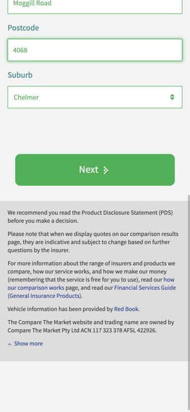
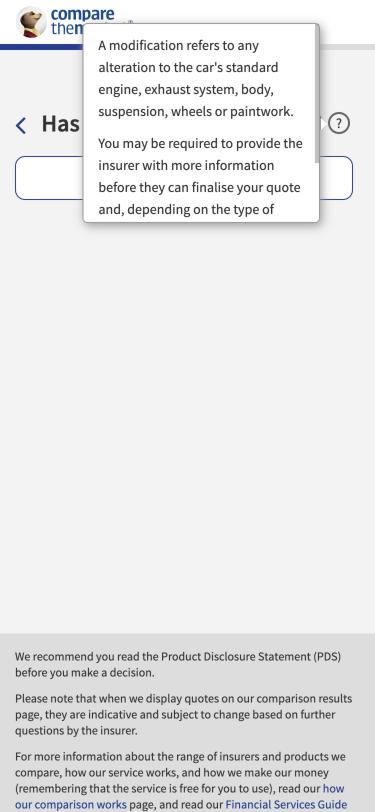

# Persona run: Jarrah, used-car buyer on his phone · coverage-sweep

**Outcome:** stopped_by_guardrail · **Furthest step:** contact details · **Would continue:** True · **Device:** mobile

**Strategy:** explore · **Persona:** dynamic · **Conditions:** {'typing_speed': 'fast', 'network': 'none', 'cpu_slowdown': 1, 'habits': ['fast thumb typing', 'taps without zooming']}

> Mostly easy on my phone, but it quietly put my address in the wrong suburb, and I had to stab at a couple of tiny links.

Mobile run through 40 steps of the live car journey, taking untested branches: Diesel, badge 'unsure', TPFT, accessories (tow bar), unrepaired damage, finance, occasional business, not insured, manual address, car park, self-employed, no comprehensive in 12 months, 1 claim, second car, renting, younger driver with a foreign licence, 25+ restriction. Stopped at contact details.

**Coverage:** Found 4 steps not seen before (standard_options, non_standard_accessories, passengers_payment, goods_payment) plus 4 younger-driver steps. Not covered: rego lookup (prod rule), results, Lease finance, Business Only, Learners/Provisional licences, desktop.

## Accessibility scan (axe-core, WCAG 2.2 AA): 10 failing rule(s)

| Who is affected | Problem | WCAG | Steps | Fix |
|---|---|---|---|---|
| Screen-reader users | Invalid ARIA markup, so the tab state may be announced wrongly (`aria-allowed-attr`) | 4.1.2 | 1 | aria-selected=" true " is not allowed (stray spaces) See https://dequeuniversity.com/rules/axe/4.10/aria-allowed-attr |
| Screen-reader users | Tabs aren't inside a tab list, so they aren't announced as tabs (`aria-required-parent`) | 1.3.1 | 1 | Required ARIA parent role not present: tablist See https://dequeuniversity.com/rules/axe/4.10/aria-required-parent |
| Screen-reader users | An ARIA value is malformed (e.g. ' true ' with spaces) (`aria-valid-attr-value`) | 4.1.2 | 1 | Invalid ARIA attribute value: aria-selected=" true " See https://dequeuniversity.com/rules/axe/4.10/aria-valid-attr-value |
| Low-vision users | Text too faint to read comfortably (`color-contrast`) | 1.4.3 | 15 | Contrast 4.45 (#787573 on #fcfcfb, 12px); expected 4.5:1 See https://dequeuniversity.com/rules/axe/4.10/color-contrast |
| Screen-reader users | A form field has no name, so it's announced as just 'edit text' (`label`) | 1.3.1 / 4.1.2 | 1 | Building Name input has no programmatic label See https://dequeuniversity.com/rules/axe/4.10/label |
| Colour-blind users | A link looks like plain text (colour is the only difference) (`link-in-text-block`) | 1.4.1 | 1 | Link contrast 1.3:1 with surrounding text and no underline See https://dequeuniversity.com/rules/axe/4.10/link-in-text-block |
| Screen-reader and keyboard users | A control is nested inside another, so focus and announcements break (`nested-interactive`) | 4.1.2 | 1 | Element has focusable descendants See https://dequeuniversity.com/rules/axe/4.10/nested-interactive |
| Keyboard users | A scrolling box can't be reached or scrolled with the keyboard (`scrollable-region-focusable`) | 2.1.1 | 1 | Element should be focusable or contain focusable content See https://dequeuniversity.com/rules/axe/4.10/scrollable-region-focusable |
| Screen-reader users | A dropdown has no name; users don't know what they're choosing (`select-name`) | 4.1.2 | 1 | Unit type and Suburb selects have no accessible name See https://dequeuniversity.com/rules/axe/4.10/select-name |
| Motor-impaired and mobile users | Tap targets are too small to hit reliably (`target-size`) | 2.5.8 | 1 | Target partially obscured (345px by 10px); should be at least 24px by 24px See https://dequeuniversity.com/rules/axe/4.10/target-size |

_Rule details are listed as A-numbered findings below._

## Findings (16)

### 🟧 F01 [major/data] Manual address: suburb silently pre-selected (first alphabetical) after postcode
- **Step:** address · **Confidence:** 0.9 · **URL:** https://www.comparethemarket.com.au/car-insurance/journey/car_address
- **Observed:** Manual address entry, postcode 4068: the Suburb dropdown auto-selected 'Chelmer' (first of Chelmer / Indooroopilly / Taringa), showed it green as valid and enabled Next. The field sits below the fold on mobile.
- **Expected:** No default when a postcode has several suburbs; require an explicit choice (auto-select only a single-suburb postcode).
- **Persona impact:** Quote and policy priced for the wrong suburb without the customer noticing.
- **Repro:** Address step → Enter it manually → Street 322 Moggill Road → Postcode 4068 → Suburb shows Chelmer
- **Suggested fix:** Default the suburb select to an empty 'Select suburb' option and validate it as required when there are multiple suburbs.
- 

### 🟨 F02 [minor/data] Typing a whole date of birth in one go keeps only the day; the rest is silently lost
- **Step:** youngest driver DOB · **Confidence:** 0.9 · **URL:** https://www.comparethemarket.com.au/car-insurance/journey/youngest_driver_dob
- **Observed:** Typing 01011980 into DD kept '01' and left MM and YYYY empty; no auto-advance, no message. Same on the regular-driver DOB in the 6 Nov run.
- **Expected:** Auto-advance between DD/MM/YYYY, or accept a full date pasted or typed into the first box.
- **Suggested fix:** Auto-advance focus when a segment is full and distribute pasted/typed overflow across the fields.

### 🟨 F03 [minor/usability] Modifications help covers the whole question on mobile and doesn't say whether accessories count
- **Step:** modifications · **Confidence:** 0.8 · **URL:** https://www.comparethemarket.com.au/car-insurance/journey/modifications
- **Observed:** On a 375px phone the '?' popover covers the question and both answers. It defines modifications but not whether an accessory already declared (tow bar) counts.
- **Expected:** Help that doesn't hide the answers; a line on accessories vs modifications.
- **Persona impact:** Unsure customers guess; a wrong answer can affect a claim.
- **Suggested fix:** Render help inline below the question on small screens; add 'Accessories you declared on the previous step are not modifications'.
- 

### 🟨 F04 [minor/usability] Small inline text links need a precise tap on mobile ('click here', 'Enter it manually')
- **Step:** badge / address · **Confidence:** 0.6 · **URL:** https://www.comparethemarket.com.au/car-insurance/journey/car_badge
- **Observed:** Thumb taps on 'click here' (badge unsure) and 'Enter it manually' missed and did nothing; both worked only with an exact tap. axe target-size also fails on the series list.
- **Expected:** Touch targets at least 24x24px (WCAG 2.5.8), ideally 44px.
- **Suggested fix:** Make these links buttons or add padding so the tap area is at least 44px tall.

### 🟨 A01 [minor/accessibility] Accessibility: Invalid ARIA markup, so the tab state may be announced wrongly (car-insurance, WCAG 4.1.2)
- **Step:** /car-insurance · **Confidence:** 1.0 · **URL:** https://www.comparethemarket.com.au/car-insurance
- **Observed:** 2 element(s) fail axe rule 'aria-allowed-attr' (, axe impact critical) on 1 step(s): /car-insurance. e.g. #tab-0-tab: 
- **Expected:** Ensure an element's role supports its ARIA attributes
- **Suggested fix:** aria-selected=" true " is not allowed (stray spaces) See https://dequeuniversity.com/rules/axe/4.10/aria-allowed-attr

### 🟨 A02 [minor/accessibility] Accessibility: Tabs aren't inside a tab list, so they aren't announced as tabs (standard_options, WCAG 1.3.1)
- **Step:** /car-insurance/journey/standard_options · **Confidence:** 1.0 · **URL:** https://www.comparethemarket.com.au/car-insurance/journey/standard_options
- **Observed:** 2 element(s) fail axe rule 'aria-required-parent' (, axe impact critical) on 1 step(s): /car-insurance/journey/standard_options. e.g. #factory: 
- **Expected:** Ensure elements with an ARIA role that require parent roles are contained by them
- **Suggested fix:** Required ARIA parent role not present: tablist See https://dequeuniversity.com/rules/axe/4.10/aria-required-parent

### 🟨 A03 [minor/accessibility] Accessibility: An ARIA value is malformed (e.g. ' true ' with spaces) (car-insurance, WCAG 4.1.2)
- **Step:** /car-insurance · **Confidence:** 1.0 · **URL:** https://www.comparethemarket.com.au/car-insurance
- **Observed:** 2 element(s) fail axe rule 'aria-valid-attr-value' (, axe impact critical) on 1 step(s): /car-insurance. e.g. #tab-0-tab: 
- **Expected:** Ensure all ARIA attributes have valid values
- **Suggested fix:** Invalid ARIA attribute value: aria-selected=" true " See https://dequeuniversity.com/rules/axe/4.10/aria-valid-attr-value

### 🟨 A04 [minor/accessibility] Accessibility: Text too faint to read comfortably (15 steps, WCAG 1.4.3)
- **Step:** /* · **Confidence:** 1.0 · **URL:** https://www.comparethemarket.com.au/car-insurance
- **Observed:** 30 element(s) fail axe rule 'color-contrast' (, axe impact serious) on 15 step(s): /car-insurance, /car-insurance/journey/start, /car-insurance/journey/standard_options, /car-insurance/journey/car_address, /car-insurance/journey/car_make, /car-insurance/journey/car_year, /car-insurance/journey/car_model, /car-insurance/journey/non_standard_accessories …. e.g. .text-greyscale-300 > p: 
- **Expected:** Ensure the contrast between foreground and background colors meets WCAG 2 AA
- **Suggested fix:** Contrast 4.45 (#787573 on #fcfcfb, 12px); expected 4.5:1 See https://dequeuniversity.com/rules/axe/4.10/color-contrast

### 🟨 A05 [minor/accessibility] Accessibility: A form field has no name, so it's announced as just 'edit text' (car_address, WCAG 1.3.1 / 4.1.2)
- **Step:** /car-insurance/journey/car_address · **Confidence:** 1.0 · **URL:** https://www.comparethemarket.com.au/car-insurance/journey/car_address
- **Observed:** 1 element(s) fail axe rule 'label' (, axe impact critical) on 1 step(s): /car-insurance/journey/car_address. e.g. #coverDetail\.overnightParking\.address\.buildingName: 
- **Expected:** Ensure every form element has a label
- **Suggested fix:** Building Name input has no programmatic label See https://dequeuniversity.com/rules/axe/4.10/label

### 🟨 A06 [minor/accessibility] Accessibility: A link looks like plain text (colour is the only difference) (car_address, WCAG 1.4.1)
- **Step:** /car-insurance/journey/car_address · **Confidence:** 1.0 · **URL:** https://www.comparethemarket.com.au/car-insurance/journey/car_address
- **Observed:** 1 element(s) fail axe rule 'link-in-text-block' (, axe impact serious) on 1 step(s): /car-insurance/journey/car_address. e.g. #overnightParkingAddressToggle: 
- **Expected:** Ensure links are distinguished from surrounding text without relying on color
- **Suggested fix:** Link contrast 1.3:1 with surrounding text and no underline See https://dequeuniversity.com/rules/axe/4.10/link-in-text-block

### 🟨 A07 [minor/accessibility] Accessibility: A control is nested inside another, so focus and announcements break (start, WCAG 4.1.2)
- **Step:** /car-insurance/journey/start · **Confidence:** 1.0 · **URL:** https://www.comparethemarket.com.au/car-insurance/journey/start
- **Observed:** 1 element(s) fail axe rule 'nested-interactive' (, axe impact serious) on 1 step(s): /car-insurance/journey/start. e.g. .registration_number__none__tEhej: 
- **Expected:** Ensure interactive controls are not nested
- **Suggested fix:** Element has focusable descendants See https://dequeuniversity.com/rules/axe/4.10/nested-interactive

### 🟨 A08 [minor/accessibility] Accessibility: A scrolling box can't be reached or scrolled with the keyboard (car-insurance, WCAG 2.1.1)
- **Step:** /car-insurance · **Confidence:** 1.0 · **URL:** https://www.comparethemarket.com.au/car-insurance
- **Observed:** 2 element(s) fail axe rule 'scrollable-region-focusable' (, axe impact serious) on 1 step(s): /car-insurance. e.g. #david-koch-car-insurance-transcript: 
- **Expected:** Ensure elements that have scrollable content are accessible by keyboard
- **Suggested fix:** Element should be focusable or contain focusable content See https://dequeuniversity.com/rules/axe/4.10/scrollable-region-focusable

### 🟨 A09 [minor/accessibility] Accessibility: A dropdown has no name; users don't know what they're choosing (car_address, WCAG 4.1.2)
- **Step:** /car-insurance/journey/car_address · **Confidence:** 1.0 · **URL:** https://www.comparethemarket.com.au/car-insurance/journey/car_address
- **Observed:** 2 element(s) fail axe rule 'select-name' (, axe impact critical) on 1 step(s): /car-insurance/journey/car_address. e.g. #coverDetail\.overnightParking\.address\.unitType: 
- **Expected:** Ensure select element has an accessible name
- **Suggested fix:** Unit type and Suburb selects have no accessible name See https://dequeuniversity.com/rules/axe/4.10/select-name

### 🟨 A10 [minor/accessibility] Accessibility: Tap targets are too small to hit reliably (car_series, WCAG 2.5.8)
- **Step:** /car-insurance/journey/car_series · **Confidence:** 1.0 · **URL:** https://www.comparethemarket.com.au/car-insurance/journey/car_series
- **Observed:** 9 element(s) fail axe rule 'target-size' (, axe impact serious) on 1 step(s): /car-insurance/journey/car_series. e.g. #internal-link-KIA\ 18AQ: 
- **Expected:** Ensure touch targets have sufficient size and space
- **Suggested fix:** Target partially obscured (345px by 10px); should be at least 24px by 24px See https://dequeuniversity.com/rules/axe/4.10/target-size

### 🔹 F05 [observation/functional] Foreign licence branch asks nothing about country or time driving in Australia
- **Step:** youngest driver licence · **Confidence:** 0.5 · **URL:** https://www.comparethemarket.com.au/car-insurance/journey/youngest_driver_licence_age
- **Observed:** Choosing Foreign Licence goes straight to 'age licence received'; no country, conversion or years-in-Australia question.
- **Expected:** Confirm with product whether insurers on the panel need this; if so, ask it here rather than at the insurer.

### 🔹 F06 [observation/trust] 'Yes' to unrepaired hail damage has no follow-up or explanation of impact
- **Step:** unrepaired damage · **Confidence:** 0.5 · **URL:** https://www.comparethemarket.com.au/car-insurance/journey/accident_hail_damage
- **Observed:** After Yes the journey moves straight on; no question about extent and no note that some insurers may exclude or decline.
- **Expected:** A short note on what happens next, or a follow-up if insurers need detail.

## Re-checks of known findings

- K003: **still_present**: Bundled consent checkbox unchanged on mobile.
- K005: **still_present**: Badge 'unsure' list for 2018 Sorento: four UM variants with identical specs; only the badge differs.
- K006: **still_present**: TPFT offered and accepted for a 2018 Sorento with no market-value check; help popovers cover options on mobile.
- K007: **still_present**: DOB Next looks disabled with a valid date; tapping it works (visual only).
- K008: **still_present**: Address page title still 'Cover Type - Car Quote'.
- K009: **still_present**: Car Park and Parking Lot both offered.
- K012: **still_present**: Empty email field shown green.
- K004: **still_present**: ~4-6s blank or faded screen per step on mobile; 7,296 console messages over the session.
- K002: **not_reproduced**: Fast typing 1995 in YYYY stored correctly on mobile. Digit-dropping on one-go entry reproduced (see new finding).
- K010: **not_reproduced**: Likely a false positive: 'None' full years is valid after Yes (insured under 12 months). After No, the 5-year option is correctly removed.

## Technical signals
- Console errors: 0 · Failed requests: 0 · Slow requests: 0 · Guardrail events: 0
- Synthetic traffic tag `?automated-test=true`: present on every step (URL parameter or the site's tag cookie)
  - Landing URL carried ?automated-test=true; the site set cookie automated-test=true, present on all 38 journey steps (verified per step).

## Run
- Stop reason: finished · Turns: 0 · Actions: 0
- Tokens: input 0 · cache read 0 · cache write 0 · output 0
- Trace: `trace.jsonl` · Screenshots: `shots/`
